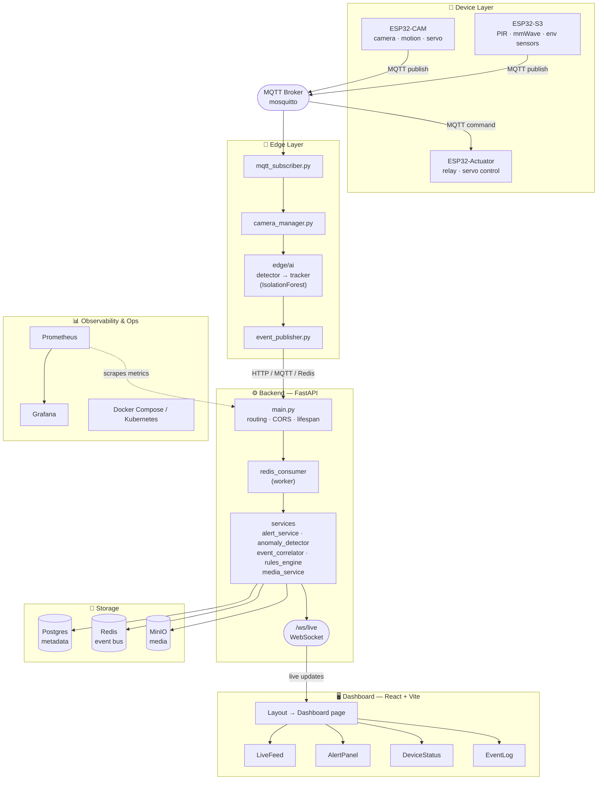

# Sentinel-X

Distributed Edge AI Surveillance Platform — ESP32 camera/sensor/actuator nodes, FastAPI backend, Redis event bus, and a React dashboard.

## System Architecture



**Data flow:** sensor/camera events publish from the ESP32 nodes over MQTT → the edge gateway consumes them, runs the AI detector/tracker, and republishes enriched events → the FastAPI backend's Redis consumer worker ingests them, applies the rules engine/event correlator/alert service, and persists to Postgres + MinIO → clients get live updates over `/ws/live`, rendered by the React dashboard. Alerts can trigger commands back to actuator nodes over MQTT.

## File Architecture

```text
vigil/
├── .env.example                      # Environment variable template
├── .github/workflows/ci.yml          # CI: backend tests, dashboard typecheck/lint, AI pipeline
├── scripts/run.sh                    # Local dev helper
│
├── firmware/                         # Arduino/PlatformIO device code
│   ├── esp32-cam/
│   │   ├── include/config.h
│   │   └── src/{main,camera,motion_detector,servo_control,mqtt_client}.cpp
│   ├── esp32-s3/
│   │   ├── include/config.h
│   │   └── src/{main,env_sensors,mmwave_radar,pir_sensor,mqtt_client}.cpp
│   └── esp32-actuator/
│       └── src/{main,relay_control,mqtt_client}.cpp
│
├── edge/                             # Edge AI gateway (runs near the cameras)
│   ├── config/settings.yaml
│   ├── gateway/{camera_manager,event_publisher,mqtt_subscriber}.py
│   └── ai/
│       ├── {detector,tracker,pipeline,train}.py
│       └── models/{anomaly_model.joblib, scaler.joblib, metadata.json}
│
├── backend/                           # FastAPI core service
│   ├── app/
│   │   ├── main.py                    # app wiring, lifespan, CORS, websocket
│   │   ├── api/
│   │   │   ├── routes/{events,devices,cameras,alerts}.py
│   │   │   └── websocket.py
│   │   ├── core/{config,database,security}.py
│   │   ├── models/{alert,device,event}.py
│   │   ├── services/{alert_service,anomaly_detector,event_correlator,rules_engine,media_service}.py
│   │   └── workers/redis_consumer.py
│   ├── tests/{test_alert_service,test_anomaly_detector,test_event_handlers,test_schemas}.py
│   └── requirements.txt
│
├── dashboard/                         # React + Vite frontend
│   └── src/
│       ├── main.tsx / App.tsx
│       ├── pages/Dashboard.tsx
│       ├── hooks/useWebSocket.ts
│       └── components/{Layout,LiveFeed,AlertPanel,DeviceStatus,EventLog}/*.tsx
│
└── infrastructure/
    ├── docker/{docker-compose.yml, mosquitto/, prometheus/}
    ├── grafana/dashboards/sentinel-x.json
    └── k8s/{backend-deployment,redis-statefulset,ingress}.yaml
```

## Getting Started

### 1. Backend

```bash
cp .env.example .env
# edit .env with your credentials
cd backend
pip install -r requirements.txt
python -m app.main   # or: uvicorn app.main:app --reload
```

Backend runs on `http://localhost:8000`; websocket at `ws://localhost:8000/ws/live`.

### 2. Dashboard

```bash
cd dashboard
npm install
npm run dev          # http://localhost:5173
npm run build        # typecheck + production build
```

### 3. Edge AI (model training)

```bash
pip install -r edge/requirements.txt
python edge/ai/train.py   # trains + saves models/anomaly_model.joblib
```

### 4. Infrastructure

See `infrastructure/` for mosquitto, redis, postgres, minio, Grafana, Prometheus, and k8s manifests.

> Note: `docker-compose` historically referenced a hardcoded plaintext password; use `.env.example` and inject secrets via your orchestrator instead.

## Testing

```bash
cd backend
pip install pytest pytest-asyncio httpx
python -m pytest tests -v
```

## CI

GitHub Actions workflow in `.github/workflows/ci.yml` runs backend tests, dashboard typecheck/lint, and the AI training pipeline on every push/PR to `main`.
